# Mobile Maia

**By Maia fans, for Maia fans.** Mobile Maia is a community project for playing and studying chess with Maia on Android. It will always be free, never show ads, and always remain open source.

**What we’re working towards**

- **Control over settings.** Let players adjust Maia’s rating, move variety, timing, and analysis settings.
- **Keep up with Maia.** Follow Maia’s development and make new models available on Android.
- **Understand its choices.** Show Maia’s move probabilities and explain how settings affect move selection.
- **Play on screen or on a board.** Support in-app play and physical electronic chessboards.
- **Useful game options.** Support multiple stacked premoves, flexible time controls, takebacks, and draw offers.
- **More languages.** Make Mobile Maia accessible to chess players in their own language, with help from community contributors.

The app uses the human-like [Maia-3](https://github.com/CSSLab/maia3) 79M model from the University of Toronto’s Computational Social Science Lab for play and analysis, alongside Stockfish for comparison and game review. Everything runs locally on your phone, without an account or Internet connection.

Choose a Maia level from 600 to 2600, compare the move a person is likely to
play with Stockfish's best move, or run a complete game review without a daily
quota. Mobile Maia is an independent community project released under
AGPL-3.0-only.

## Community

Join the [Mobile Maia community on Flotilla](https://app.flotilla.social/join?r=mobilemaia.spaces.flotilla.social&c=slusagresp6) to ask questions,
share games, discuss settings, and help test Preview. We’re starting with a
small pilot, currently limited to 10 members. You’ll need a Flotilla/Nostr
account to join.

Please keep using the relevant GitHub issue tracker for reproducible bugs
and feature requests.

## Download and install

[](https://f-droid.org/packages/com.dash1971.maia_chess/)

- **F-Droid:** [Install through the official F-Droid repository](#install-and-update-with-f-droid).
- **Direct APK:** [Download the latest Stable release from GitHub](https://github.com/Dash1971/maia-chess-android/releases/latest).
- **Obtainium:** [Install and receive updates from GitHub releases](#install-and-update-with-obtainium).
- **Zapstore:** [Install from the developer-published listing](#install-and-update-with-zapstore).

F-Droid updates become available after its separate reproducible-build process
completes.

A progressive web app (PWA) version is being developed at
[mobilemaia.org](https://mobilemaia.org/). You can already
[try Mobile Maia in your browser](https://mobilemaia.org/play/) using the
smaller Maia-3 5M model. The current browser edition is not yet an installable
or offline PWA.

## Contents

- [Community](#community)
- [Download and install](#download-and-install)
- [Mobile Maia 2.5](#mobile-maia-25)
- [Feature guide](#feature-guide)
- [Google Play, iPhone, and forks](#availability-and-forks)
- [Support and contributing](#support-and-contributing)
- [Build and reproducibility](#build)
- [Re-export Maia-3](#re-export-maia-3)
- [Credits and attributions](#credits-and-attributions)
- [Licensing](#licensing)

## Mobile Maia 2.5

Mobile Maia 2.5 brings appearance choices, board designs, clearer Maia help,
optional score estimates, and more ways to set up and continue positions.

- **Make the app your own.** Choose Light, Dark or System default, Android system colors and an optional pure-black background. The original green/dark appearance remains the default.
- **Choose your board.** Pick from 25 boards and 16 approved piece sets, and control coordinates, legal-move dots, highlights, animation and dragging aids.
- **Balanced new-install defaults.** Play and primary analysis start at Maia 1500; the optional second analysis engine starts at 2600. Temperature 1.0 / Top-P 0.95 with opening variety on keeps the full opening repertoire for five moves. Existing choices and saved-game profiles are preserved.
- **Understand Maia.** One scrollable engine-help guide explains sampling, examples and research. An optional Maia score in Analysis Board and Game Review estimates expected game points, including half-point draws.
- **Set up and continue positions.** Use graphical editor palettes, move/erase tools and FEN copy/share. Continue an analysis position on screen or as an untimed Chessnut game with physical-position setup guidance.
- **Explore variations more easily.** Hold Left to return to a variation's main-line branch point; hold Right to go one main-line move beyond it. Navigation also clears stale selections and drag indicators.

[2.5.1](docs/release-notes/v2.5.1.md) fixes a crash when analyzing certain custom positions.

See the [2.5 release notes](docs/release-notes/v2.5.0.md),
[2.4 release notes](docs/release-notes/v2.4.0.md) and
[earlier release notes](docs/release-notes).

Active development continues in the separate
[Mobile Maia Preview repository](https://github.com/Dash1971/maia-chess-android-preview).
Its gold-icon app has a separate Android package and can be installed beside
this stable blue-icon app.

## Feature guide

The current 2.5 images below are actual Android captures of the Stable 2.5.0
app on 27 October 2026, visually checked before use. Appearance and optional
engine examples identify their selected settings. Other dated images remain
explicitly older illustrative examples. See [capture provenance](docs/screenshots/20261027_v1_stable_2_5_provenance.md).

### Choose a game or analysis workflow

<p align="center">
  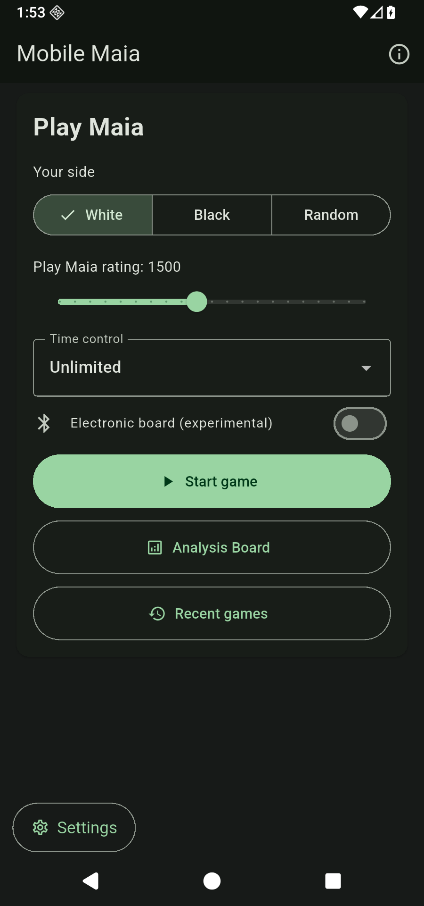
</p>

*Stable 2.5.0 Home with its new-install defaults.*

The home screen is the starting point for every workflow. Play as White, Black,
or a random side; choose a preset or custom **Play Maia rating**; then start a game.
**Analysis Board** opens a free-form position, **Recent games** restores saved
work, and PGN files can be imported through Analysis Board or Android's Open
with action. Your side, rating, clock, custom time values, and advanced settings
are remembered locally.

### Time controls

<p align="center">
  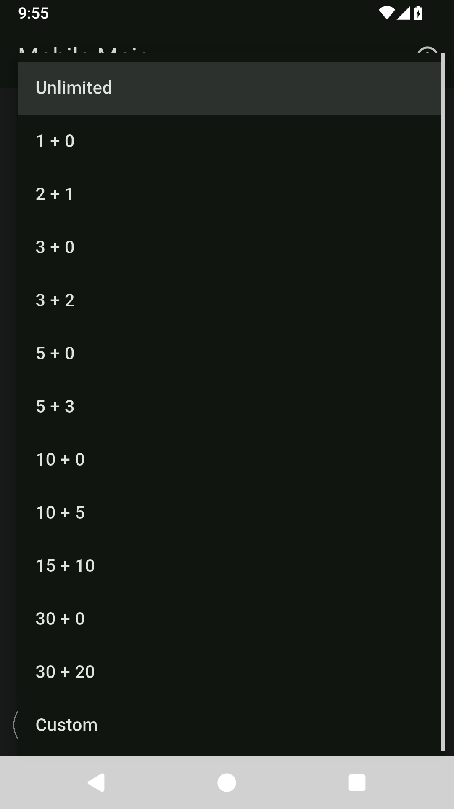
</p>

*Older illustrative capture; current labels and defaults are described in the text.*

Games are unlimited by default. The quick controls follow Lichess's order:
**1+0, 2+1, 3+0, 3+2, 5+0, 5+3, 10+0, 10+5, 15+10, 30+0, 30+20**.
The first number is minutes per player; the second is seconds added after each
move. Custom minutes and increment are also available. Training clocks pause while the app is in the
background, while you review the current game, or after an engine error. Timed
PGNs use a standard `TimeControl` header and per-move `[%clk ...]` comments to
millisecond precision; unlimited games do not invent clock data.

### Human move timing

Human move timing is optional and off by default. When enabled, Maia varies
its pauses to give games a more natural rhythm. Shorter pauses are more common
than longer ones. The configured time control selects the timing automatically:

| Time control | Average move-time target | Maximum target |
| --- | --- | --- |
| 1+0 | About 1 second | 3 seconds |
| 2+1, 3+0, 3+2 | About 1.5 seconds | 4.5 seconds |
| 5+0 and longer presets; Unlimited | About 2 seconds | About 9 seconds |

The default draw is normally 0.55–4.5 seconds, with a 6% chance of an additional
1.5–4.5 seconds. Faster tiers scale that whole sample and then cap it. Matching
Custom controls use the same faster tiers; other Custom controls keep the
original distribution. These are random pauses, not a measure of position
difficulty, and they do not shorten automatically when the remaining clock is low.

Calculation time counts toward the target. If the move is ready after 0.2
seconds and the target is 1.8 seconds, the app waits another 1.6 seconds. If
calculation already takes 2.3 seconds, it adds no extra wait. Actual times can
therefore exceed the target, and timed games can still end on the clock.

### Interface language

Open **Settings → Language** to follow the system or select English, 日本語,
简体中文, 한국어, Español, Deutsch, Français, Русский, हिन्दी or Português (Brasil).
Languages are listed by their native names. Switching updates the interface
without rewriting PGN notation, historical game data or engine values.
Unsupported device languages fall back to English; Simplified Chinese is not
silently substituted for a Traditional Chinese system preference.

### Appearance

<p align="center">
  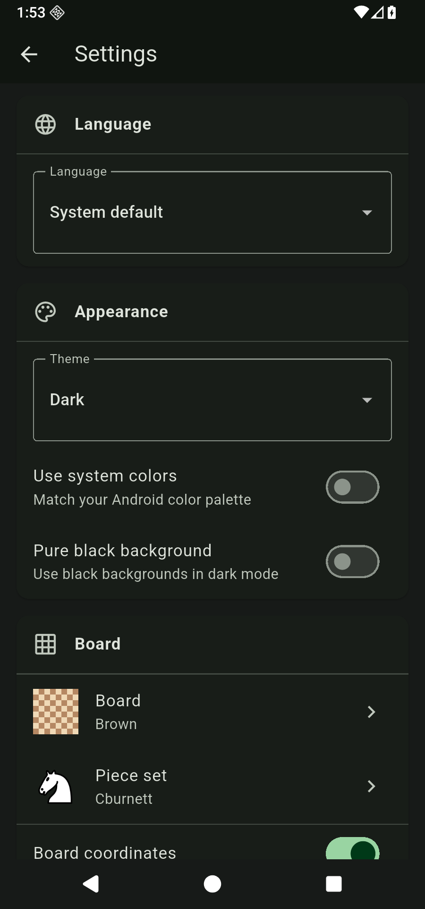
</p>

<p align="center">
  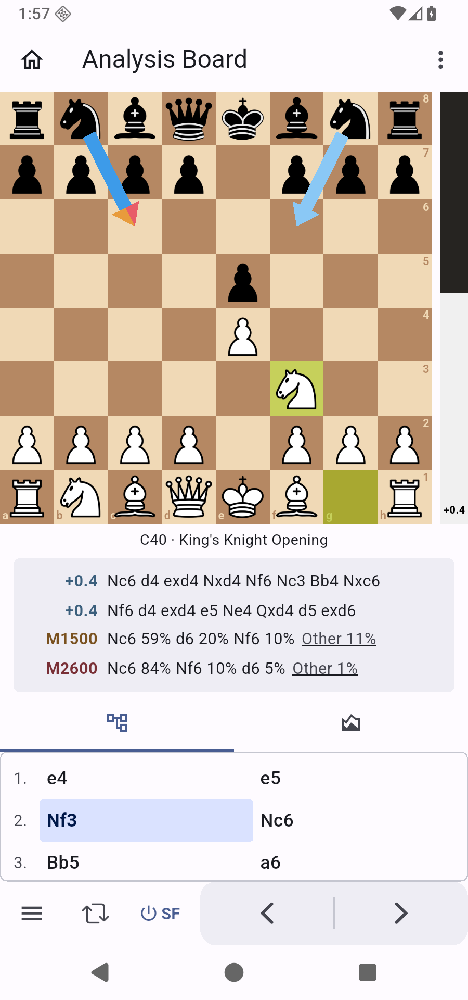
  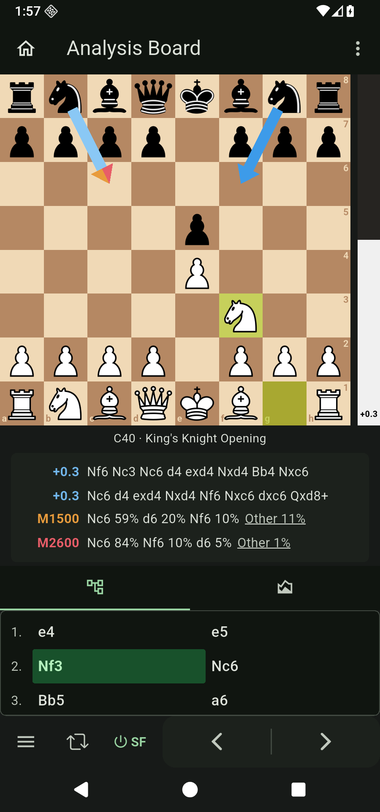
  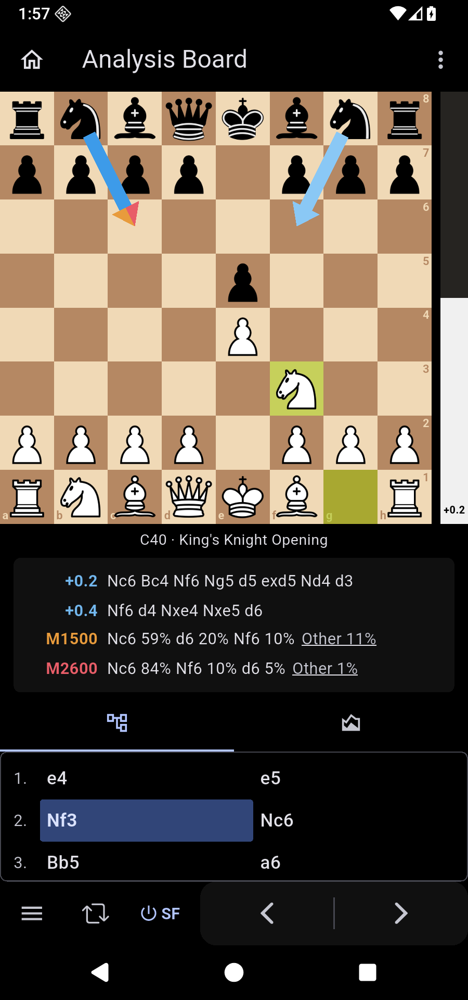
</p>

*Stable 2.5 Analysis Board in Light, default Dark and pure-black Dark modes.
The Light and pure-black examples use Android system colors. Maia score
display is off in these examples.*

Open **Settings → Appearance** to choose **Light**, **Dark** or **System
default**. **Use system colors** follows the Android palette on supported
Android 12+ devices; it is unavailable on older devices. **Pure black
background** applies in dark mode and retains its choice when you switch to
light mode. The original green-accented Dark theme, without system colors or
pure black, remains the default. Appearance and chessboard designs are separate
choices.

### Board designs and playing aids

<p align="center">
  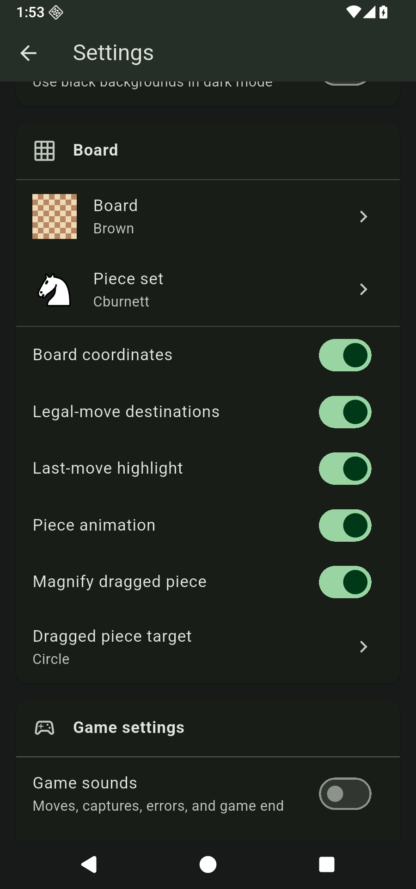
  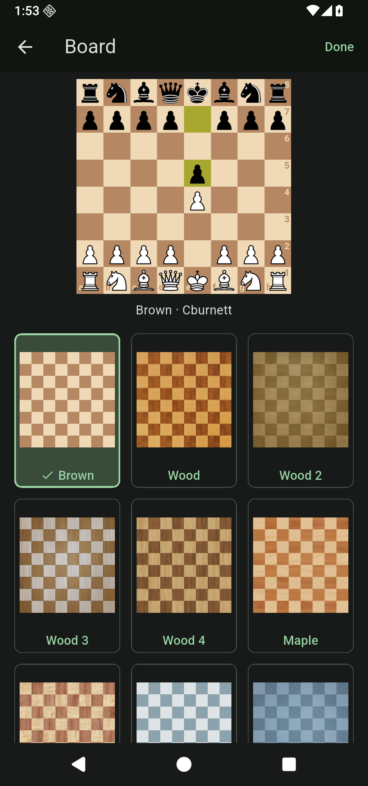
  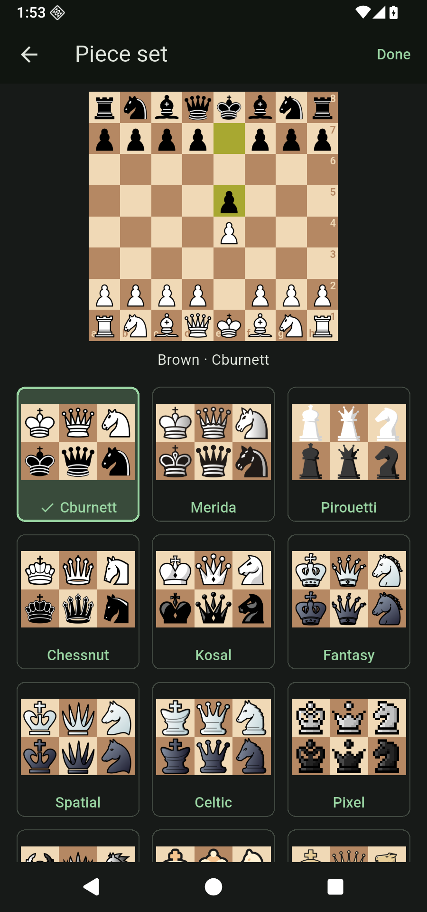
</p>

*Stable 2.5 board preferences and artwork selectors. Brown/Cburnett and the
existing aids remain the defaults.*

Open **Settings → Board** to choose from **25 boards and 16 approved piece
sets**, with a live preview. Adjust **Board coordinates**, **Legal-move
destinations**, **Last-move highlight**, **Piece animation** and **Magnify
dragged piece** independently. **Dragged piece target** offers Circle, Square
or None. The preferences apply across play, analysis and applicable editor
views and are remembered locally. Hiding the last-move highlight does not hide
check, selection, premove or analysis overlays.

### Advanced play and review settings

<p align="center">
  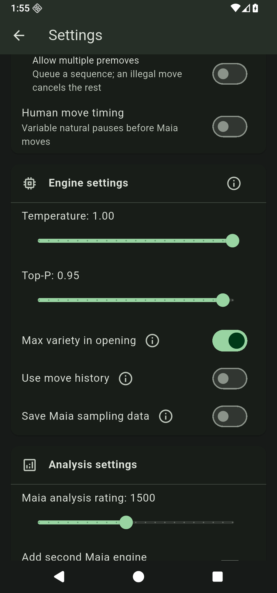
  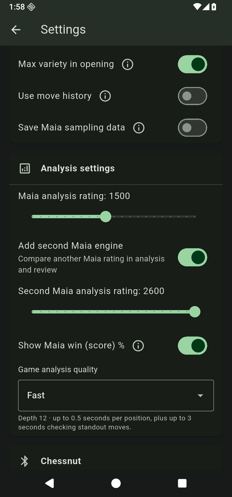
</p>

*Stable 2.5 controls. The analysis example enables the optional second engine
and score display for demonstration; both options are off by default.*

**Game** groups premoves, the indented 100 ms premove charge and multiple-premove
options, human move timing, Game sounds and Touch feedback. **Engine** groups
Temperature, Top-P, opening variety, move history and sampling data. **Analysis**
controls review ratings, the optional second Maia engine, score display and
review quality. New preferences and a confirmed Settings reset use:

| Setting | Default |
| --- | --- |
| Play Maia rating | 1500 |
| Maia analysis rating | 1500 |
| Optional second Maia analysis rating | 2600; engine off |
| Temperature / Top-P | 1.0 / 0.95 |
| Max variety in opening | On |
| Game analysis quality | Fast |
| Move history / sampling capture / Maia score display | Off |

Existing explicit preferences and frozen saved-game sampling settings are
preserved. **Balanced** and **Thorough** offer deeper Stockfish review searches.
**Copy diagnostics** creates a privacy-safe local troubleshooting report and
never uploads it automatically.

### Maia sampling and help

Maia predicts how often human players would choose each legal move.
**Temperature** changes how strongly it favors the most likely moves;
**Top-P** retains the highest-probability moves until their cumulative
probability reaches the selected threshold. It is not a minimum probability
for every individual move. At Temperature 0, Maia chooses its most likely move
and Top-P is not used.

Open the information button beside **Engine settings** for one scrollable
**Temperature and Top-P** guide, with plain-language examples, technical detail
and a research link, available in all ten languages.

<p align="center">
  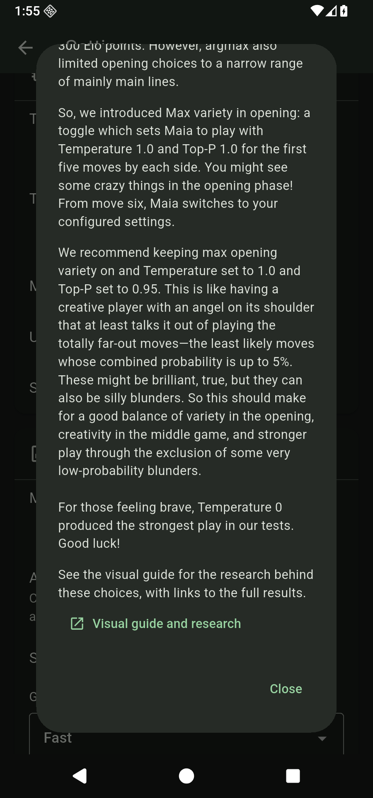
</p>

*Stable 2.5 engine help, scrolled near the end.*

The new default is **Temperature 1.0 / Top-P 0.95 with Max variety in opening
on**. This keeps unfiltered opening choices, then excludes a small tail of
unlikely moves from move 6. The selected rating remains a model input, rather
than a guarantee of measured playing strength.

Our earlier 79M research at rating inputs of 1600 found approximately **64%
e4, 25% d4 and 11% other first moves** at 1.0/1.0. In a separate 1,200-game
comparison, 1.0/0.95 gained about **71 Elo** against 1.0/1.0, with **67 opening
families rather than 85** in equal 2,000-opening samples. These are historical
measurements, not a new strength claim for 2.5's combined opening override.
Version 2.4 chose 1.0/1.0 throughout; 2.5 balances opening variety with later
play through the override.

The older **0.5 / 0.9** settings came from our
[Maia2](https://github.com/Dash1971/maia2-local-stack) and
[Maia3](https://github.com/Dash1971/maia3-local-stack) local stacks, which used
opening books. Mobile Maia has no opening book.
[See the visual report, results and reproducible data](https://github.com/Dash1971/mobile-maia-research/blob/main/studies/maia3-sampling/REPORT.md).

### Max variety in opening

This switch uses **Temperature 1.0 / Top-P 1.0 for the first five moves by each
side**, then your configured values from move 6. It is on for new preferences
and Settings reset, alongside the new 1.0/0.95 defaults. It also works with
Temperature 0: openings stay varied, then Maia chooses its most probable move
from move 6. This does not guarantee a particular strength gain.

At configured 1.0/1.0 it is off and grayed out because there is nothing to
override; its information button remains available. Returning both sliders to
1.0 clears the option. Existing preferences and saved-game profiles are not
silently changed. Takebacks and **Continue from here** use the FEN's actual
move number, rather than restarting the five-move allowance.

The idea was inspired by [Maia3-tauri](https://github.com/outusuke/maia3-tauri)
by [outusuke](https://github.com/outusuke). Mobile Maia's implementation and
five-move cutoff are its own.

### Optional move-history input

**Use move history** lets Maia consider up to seven previous positions alongside
the current position. It remains off by default and off is recommended for now.
In our 79M tests it improved human-move prediction by about 2 percentage points
(from 57.00% to 59.36%), but sometimes encouraged repeated copying in low-rated
openings; a playing-strength increase was not established. Saved games retain their recorded history setting.
[Read the research and limitations](https://github.com/Dash1971/mobile-maia-research/blob/main/studies/move-history-2026-10-09/REPORT.md).

### Save Maia sampling data

For players interested in how Maia works, **Save Maia sampling data** optionally
records its settings, probabilities and chosen moves on the device. It is off
by default and is separate from Recent games and diagnostics.

The last **ten recorded games**, including unfinished games, are saved and
exported newest first. A 64 MiB safety limit can remove older captures sooner.
Use the three-dot menu to **Save…** or **Share…**, then choose a readable offline
**HTML report** or full **JSONL research data**. Reports show known players,
results, openings, actual selection probabilities after Temperature/Top-P,
plain-language odds and move arrows on a board. Captures cover Maia decisions,
not every move in a complete PGN. Deleting captures asks for confirmation and
does not delete saved games or previously exported files.

Settings groups Language, Appearance, Board, Game, Engine, Analysis and Chessnut
options. **Reset settings to default**, above Copy diagnostics, asks for confirmation and keeps saved
games and sampling data.

### Play against a human-like opponent

<p align="center">
  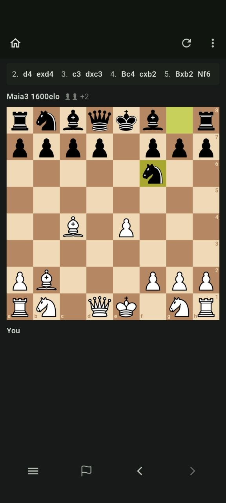
</p>

*Older illustrative capture; current labels and defaults are described in the text.*

Tap or drag pieces on the Lichess Chessground board. Maia-3 runs on-device and
selects moves for the chosen rating instead of behaving like a deliberately
weakened tactical engine. The live view shows both players, clocks, material
imbalance, the move strip, turn status, and game controls. The screen stays
awake during an active game, and the current position is checkpointed for
recovery after process death, restart, or an app update.

### Game sounds and touch feedback


Optional **Game sounds** distinguish moves, captures, invalid moves,
and game end. **Touch feedback** adds touch cues for moves, checks, errors,
and game end. Both run on the phone without a network connection. Phone
feedback is suppressed while a Chessnut board controls the game; the separate
**Board sounds** setting controls its own audible cues.

### Multiple premoves

<p align="center">
  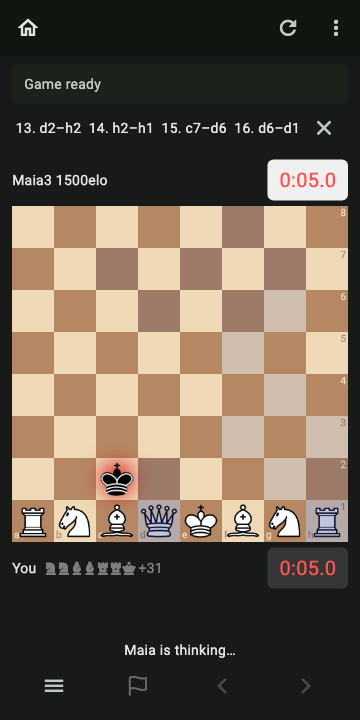
</p>

*Older illustrative capture; current labels and defaults are described in the text.*

Inspired by GM Aman Hambleton's
[“Mona Lisa” checkmate](https://www.chess.com/article/view/how-to-replicate-the-mona-lisa-checkmate),
this example queues a sixteen-move rook-and-queen plan. The strip is scrolled to
moves 13–16 and the projected board shows the signature finish: White's army
reset on its back rank with `Qd1#`. Mobile Maia previews only the player's
queued moves, not the opponent king's forced walk, so this is an homage rather
than a move-for-move reconstruction.

Queued pieces stay in their planned positions as each premove is played, while
the remaining premove highlights shrink.

Enable **Allow multiple premoves** to plan up to 64 moves while Maia is
thinking. After each Maia reply, only the next premove runs, and only if it is
legal in the actual position; an illegal move cancels everything that follows.
**Cancel premoves** clears the sequence immediately.

Premoves are available only for on-screen games. A separate setting can charge
exactly 0.1 seconds for each executed premove before applying the normal
increment. Without that setting, the default is one Lichess-style premove with
no fixed deduction. Navigation, takebacks, leaving or restarting the game, and
game completion all clear the queue.

### Navigation, takebacks, resignation, and draw offers

<p align="center">
  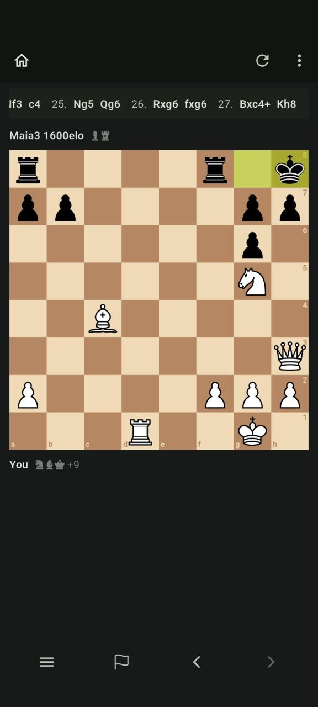
</p>

*Older illustrative capture; current labels and defaults are described in the text.*

The bottom toolbar opens game actions, resigns, and moves backward or forward
through played positions. Hold Back to jump to the starting position and hold
Forward to return to the latest position. Historical positions are read-only;
completed games also show the clock values belonging to the selected ply.

**Takeback** restores the playable board and clock while preserving the
abandoned continuation as a PGN variation. In sufficiently reduced endgames,
**Offer draw** asks for confirmation and lets local Stockfish decide whether
Maia accepts. Accepted offers are saved as draws by agreement.

### Game completion and rematches

<p align="center">
  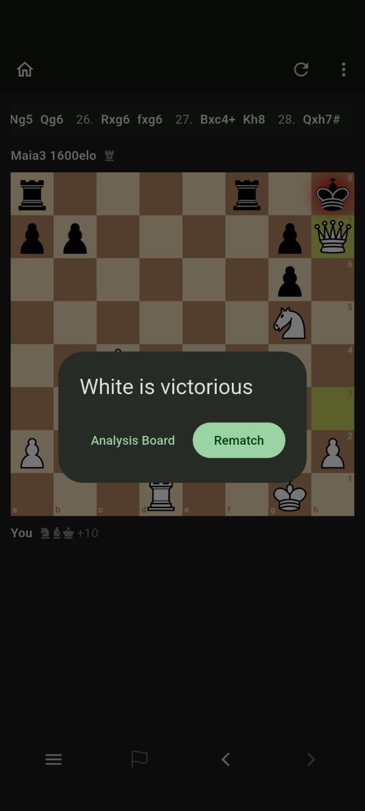
</p>

*Older illustrative capture; current labels and defaults are described in the text.*

Checkmate, stalemate, timeout, resignation, and agreed draws produce a result
dialog. Open the finished position in **Analysis Board**, start a **Rematch**,
or return Home. A completed game remains in **Recent games** when you choose
**New game**; resetting an unfinished game uses a separate destructive
confirmation.

### Chessnut electronic-board play

Experimental Chessnut support has been confirmed with both Chessnut Go and
Chessnut Air. It enters physical moves over Bluetooth and lights Maia's reply
on the board. Mobile Maia compares the complete sensed position, treats
temporary piece lifts and partial castling as unfinished, and lights mismatched
squares when correction is needed. Optional board sounds distinguish check,
checkmate, and a complete-looking illegal move.

Connect searches for recognized Chessnut boards. A single board connects
automatically; multiple candidates open a chooser. Connection messages identify
the board. The board's NEW GAME button opens the reset warning; a second press
within 2.5 seconds confirms it. The game stays on screen, keeps the colors and
waits for the LED-guided physical setup before starting again. The double-press NEW GAME Chessnut e-board behavior was inspired by [MoveAPiece](https://github.com/egdels/moveapiece) by [egdels](https://github.com/egdels).
DGT Pegasus and Square Off Grand Kingdom remain blocked in Stable pending separate acceptance.

Reconnect keeps the game and verifies the physical position before play
continues. Pending Maia and takeback lights are restored. **Play in app** moves
the same unfinished game to on-screen input while retaining its moves,
variations, rating, and orientation. Board play supports untimed games from the standard starting position or a
valid custom position through **Continue from here**. Set up the physical pieces
to match the selected position before play begins; LEDs guide mismatched squares.
The full FEN preserves whose turn it is, castling and en-passant rights. A
connection can be reused, retried, cancelled or handed back to phone play.
The requester reports that the Chessnut acceptance tests passed for this
preparation; this is user-reported hardware acceptance, separate from automated
emulator and controlled-transport checks. Other Chessnut models may use the same protocol but
have not yet been confirmed; compatibility reports from their users are
welcome. Timed board games, USB and direct physical editing/input in Analysis Board are
not yet supported.

### Analysis Board

<p align="center">
  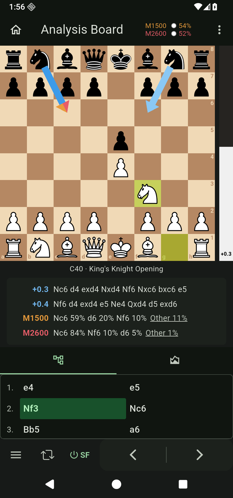
</p>

*Stable 2.5 analysis with optional Maia 1500 and 2600 scores enabled.*

Use **Analysis Board** to explore without starting a game. Stockfish supplies
two evaluated lines and blue best-move arrows. Maia supplies the move a person
at the configured rating is most likely to play; turn on the second Maia engine
to compare two ratings and probabilities side by side. The screen can show all
four lines together. When engines choose the same move, their arrows overlap or
combine. The board, move tree, selected position, orientation, and engine
context are restored across restarts.

### Optional Maia score

<p align="center">
  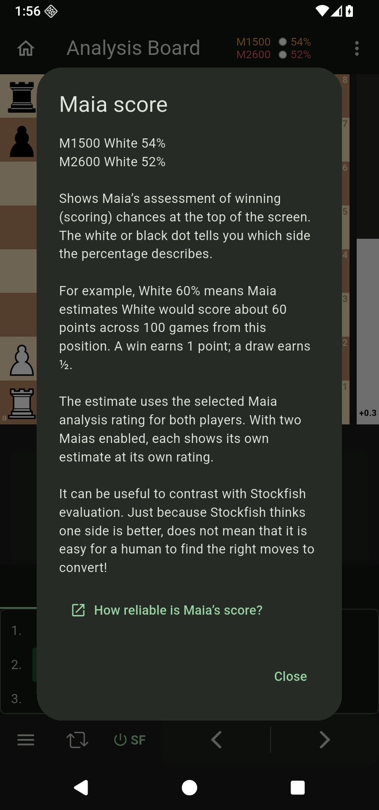
</p>

Enable **Settings → Analysis → Show Maia win (score) %** to show a compact
score beside the Analysis Board or Game Review title. It is off by default.
Each line keeps its rating, white/black disc and percentage in fixed columns
while results load or change. The disc identifies the side the number describes;
flipping the board does not change that meaning. Tap the score for full labels
and help, particularly on narrow screens where ratings may be hidden.

This is **expected score**, calculated as `P(win) + ½ × P(draw)`, rather than
literal win probability. White 60% means roughly 60 expected points in 100
games, counting a win as one and a draw as half. Each engine uses its own
analysis rating for **both players**: M1500 means 1500 versus 1500, and M2600
means 2600 versus 2600. It is separate from move-choice percentages and
Stockfish evaluation. Equal rounded scores show `= 50%`, loading shows an
ellipsis, unavailable results a dash, and terminal positions the actual result.
[How reliable is Maia’s score?](https://github.com/Dash1971/mobile-maia-research/blob/main/studies/score-reliability-2026-10-27/REPORT.md)
explains the research and its limits; the same link appears in score help.

### Move list, opening names, and engine lines

<p align="center">
  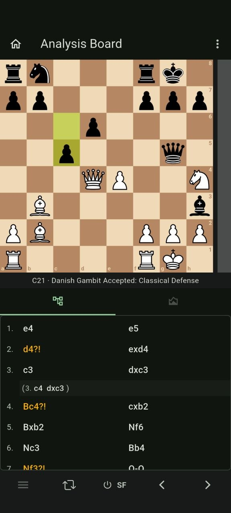
</p>

*Older illustrative capture; current labels and defaults are described in the text.*

The fixed board sits above a scrollable, clickable move list. Select any move
to inspect that position, use the arrows one ply at a time, or hold them to
jump to the beginning or end when on the main line. Inside a side variation,
**hold Left** returns to its outermost main-line branch point; **hold Right**
selects one main-line move after that point, clamped at the game end. At a
variation end the dimmed Right control cannot be tapped, but can still be held.
Navigation clears a stale selected square, legal-move dots, held drag and
promotion state so a fresh touch works immediately. The bundled Lichess CC0 opening
dataset supplies offline ECO codes, detailed variation names, and
transposition-aware matching. Long names remain on one line; an information
button appears only when the name is truncated, opening the full name without
pushing the engine panel down. Home returns directly from post-game analysis
after the app resumes or restores its screen. Interactive Stockfish analysis first returns a
quick result and then refines the same selected position.

### Why Stockfish 19 Light?

Mobile Maia bundles Stockfish 19 Light through Lichess multistockfish 0.6.1.
The move from the older Stockfish 16 integration followed a reproducible native
crash when an engine was stopped and restarted. The package upgrade and
per-engine handle lifecycle addressed that crash; choosing Light also keeps a
small NNUE in the app so analysis and full-game review work immediately and
entirely offline, without a separate download or setup. Bundling a full NNUE
for everyone would increase the app's download and storage footprint. Light
remains the default and offline fallback. An explicitly opt-in full Stockfish 19
NNUE is a separate proposal, subject to quality, device-performance, storage,
file-integrity, privacy, reproducibility, and F-Droid checks
([Preview issue #52](https://github.com/Dash1971/maia-chess-android-preview/issues/52)).

### Load, edit, continue, and clear positions

The Analysis Board actions sheet loads FEN or PGN text, opens a PGN file,
clears the move tree, opens **Board Editor**, or starts a Maia game from the
selected position.

<p align="center">
  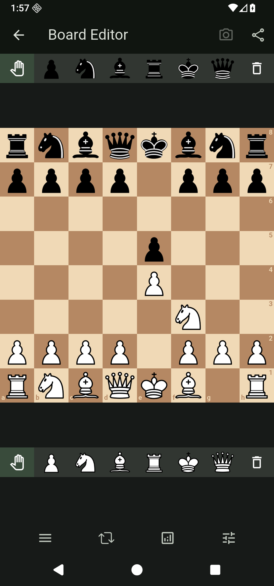
  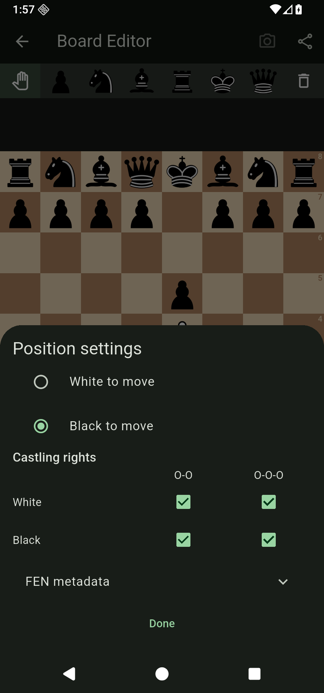
</p>

*Stable 2.5 Board Editor and Position settings.*

The editor has graphical piece palettes above and below the board. Select a
piece to place it repeatedly; tap an identical piece to remove it. Use the hand
tool to move existing pieces by tap or drag, or the erase tool to remove them.
Flip changes the view and palette order. **Position settings** controls whose
turn it is, four castling rights, en-passant target and FEN counters. The menu
loads FEN, restores the starting position, clears the board or continues play.
The share button offers **Share FEN** and **Copy FEN**. Analysis and Continue
validate the position; incomplete drafts remain editable. Image import is
labelled unavailable and is not a working feature.

<p align="center">
  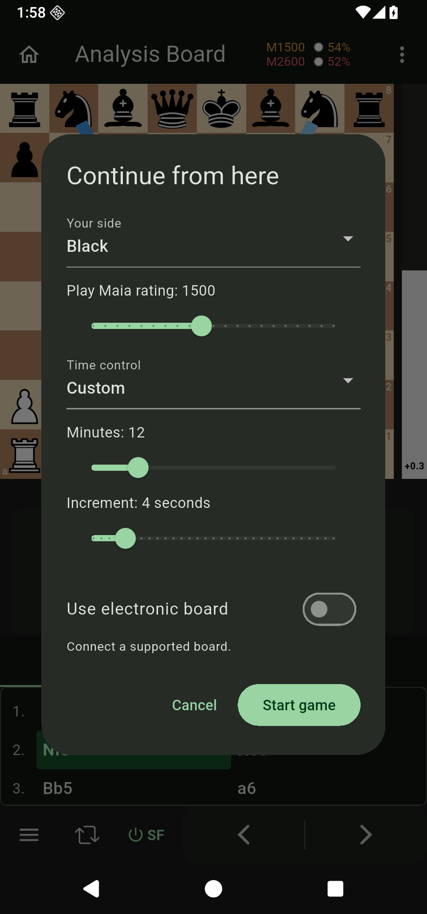
  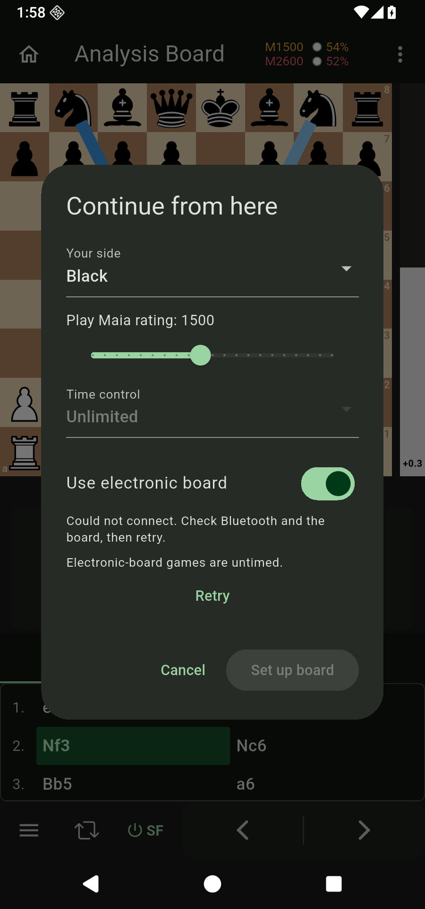
</p>

*Stable 2.5 captures: a custom phone clock and the emulator’s actual
connection-unavailable recovery. The second image does not demonstrate a
successful physical board connection.*

**Continue from here** opens a one-game setup for your side, Play Maia rating
and phone clock, including custom minutes and increment. Its choices start
from Home preferences and do not overwrite them. Enable **Use electronic
board** to connect to or reuse a Chessnut board; choose **Set up board** after
connection. Board continuation is untimed and waits for the physical pieces to
match the full selected position. Turning the option off restores the chosen
phone clock. Cancel preserves analysis; Retry handles a failed connection.
DGT Pegasus and Square Off Grand Kingdom are not enabled by this feature.

### Save and share analysis

<p align="center">
  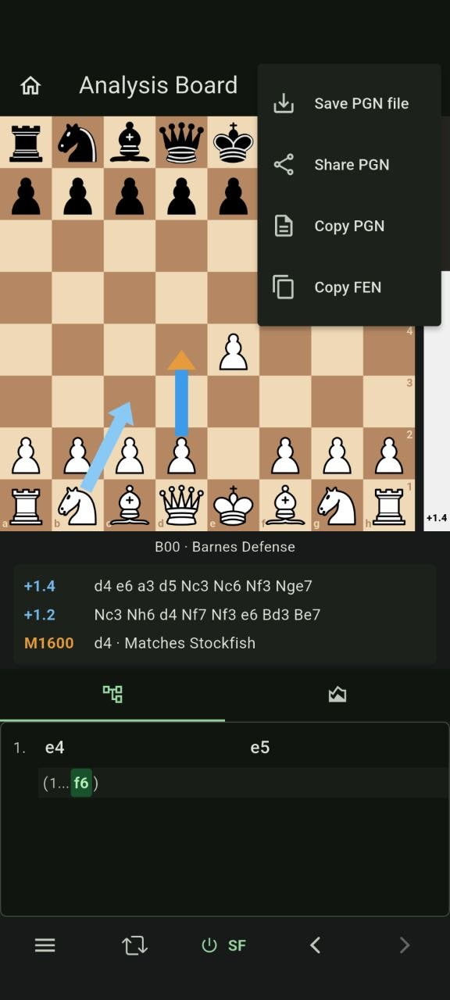
</p>

*Older illustrative capture; current labels and defaults are described in the text.*

The top menu saves or shares the complete annotated PGN, copies it to the
clipboard, or copies the current FEN. Android's system picker and temporary URI
grants are used, so storage and Internet permissions are not required.

### Build and edit variations

<p align="center">
  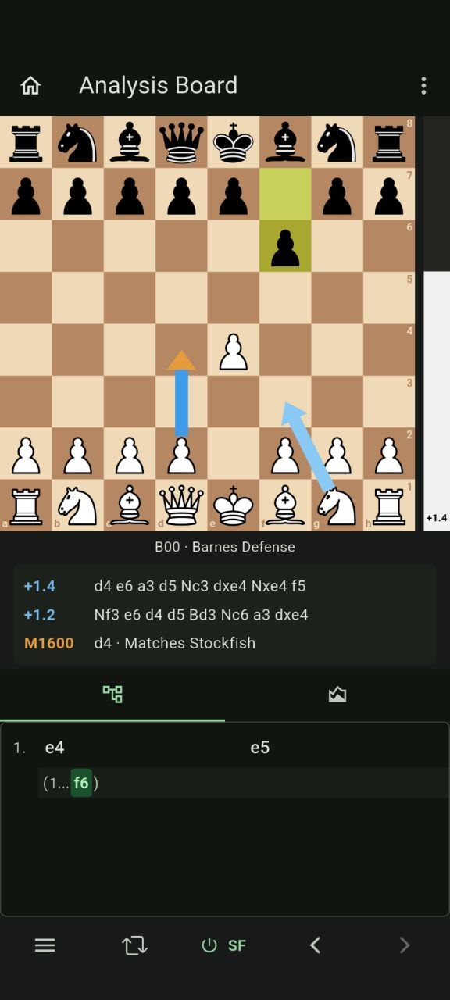
</p>

*Older illustrative capture; current labels and defaults are described in the text.*

Select an earlier move and play a different continuation to create a clickable
inline variation without deleting the original line. Long-press a move to
collapse or expand its continuation, promote it one level, make it the main
line, or delete from that point. Back navigation exits a variation at its branch
point before continuing toward the start. Variations, comments, annotations,
and takeback lines remain in exported PGN.

### Full-game computer analysis

<p align="center">
  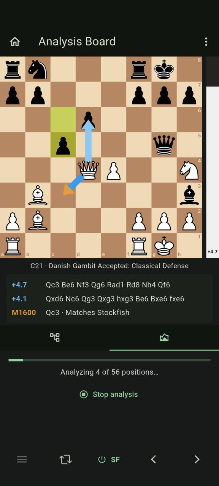
</p>

*Older illustrative capture; current labels and defaults are described in the text.*

From a completed or imported game, open **Computer** and run a full review.
Stockfish analyses every main-line position locally using the selected Fast,
Balanced, or Thorough preset. Progress is visible and cancellation is safe;
there is no server-side quota.

### Accuracy and game phases

<p align="center">
  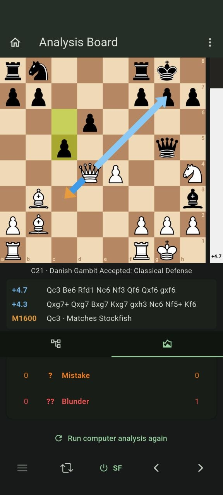
</p>

*Older illustrative capture; current labels and defaults are described in the text.*

The completed review reports separate White and Black accuracy, move totals,
and opening, middlegame, and endgame sections. Maia's likely human move remains
available beside Stockfish at every reviewed position, using the configurable
review rating (1500 for new preferences). Enable the second Maia engine to compare a
second rating (2600 for new preferences) at the same position.

### Evaluation graph and move navigation

<p align="center">
  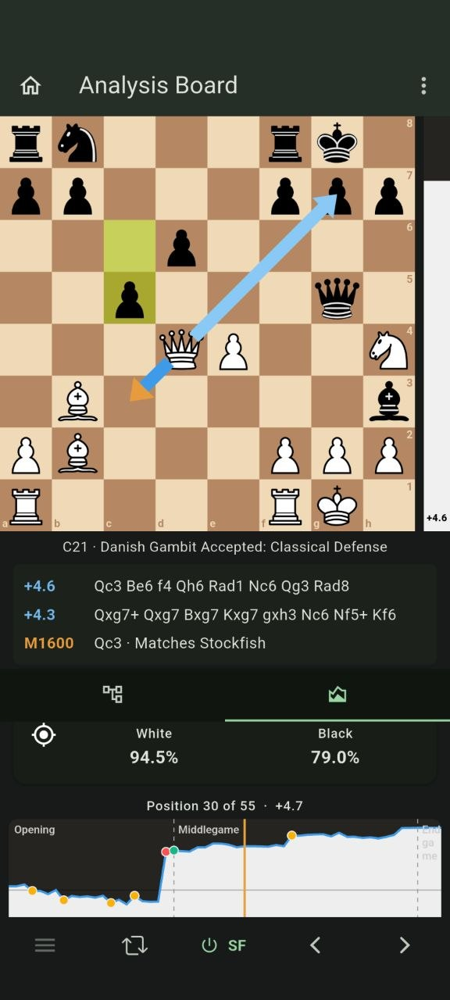
</p>

*Older illustrative capture; current labels and defaults are described in the text.*

The evaluation graph plots the game from White's perspective and marks
classified moves. Tap anywhere on it to navigate directly to that position;
the board, move highlight, evaluation bar, arrows, and current annotation stay
in sync. The numeric evaluation remains at the advantaged side and follows the
board when it is flipped.

### Move classifications

<p align="center">
  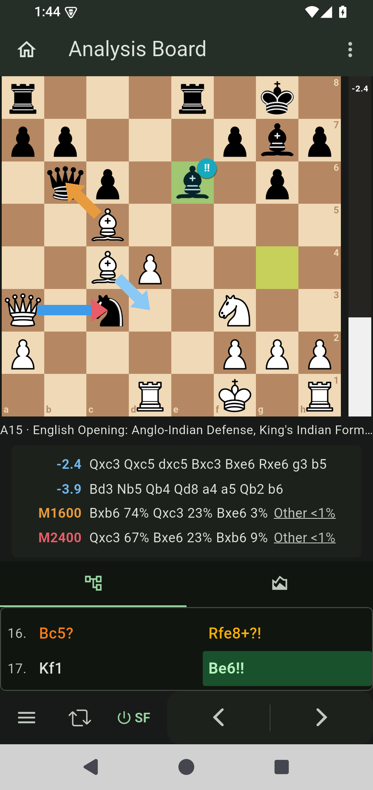
</p>

*Older illustrative capture; current labels and defaults are described in the text.*

Review classifies moves as **Brilliant**, **Good**, **Interesting**,
**Dubious**, **Mistake**, or **Blunder**, with separate totals for both players.
Version 2.2 refines the classification heuristics so Brilliant moves are more
likely to receive the correct label; these classification categories are not new.
The screenshot shows Fischer's **17...Be6!!** from the 1956 Byrne–Fischer game
classified Brilliant by the signed Stable 2.2 app. The current classification
appears on the board and in the move list. You can
move pieces from any reviewed position to explore a branch without losing the
original game.

### Recent games and PGN files

<p align="center">
  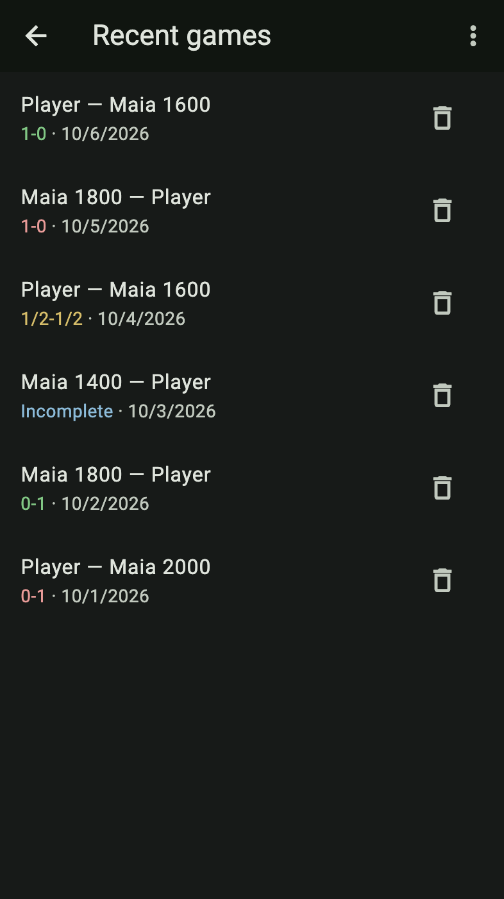
</p>

*Older illustrative capture; current labels and defaults are described in the text.*

**Recent games** contains completed games and unfinished games explicitly saved
with Home. Each entry now identifies the player side and Maia rating (for
example, **Player — Maia 1600**) and shows the actual result (**1-0**, **0-1**,
or **1/2-1/2**) or **Incomplete**, plus the original played date. Opening or
analysing a record changes neither its date nor its chronological position.
Older records without a reliable played date show **Date unknown**.
Only the result text is coloured: green for the player's win, red for a loss,
amber for a draw and blue for incomplete. A `1-0` is therefore green if you
played White and red if you played Black; unknown results stay neutral.
It supports
multi-select, select all, selected deletion, and delete all. An unfinished
record becomes the same completed record when play ends.
Because Android can erase private app data on uninstall, use **Save PGN file**
or **Share PGN** for an independent copy.

**Open PGN file**, Android's Open with action, and shared attachments import one
game with its variations, comments, and annotations. Files are limited to 2 MB
and 20,000 moves across all branches; the first game is used when a document
contains several games.

### About, privacy, and licences

<p align="center">
  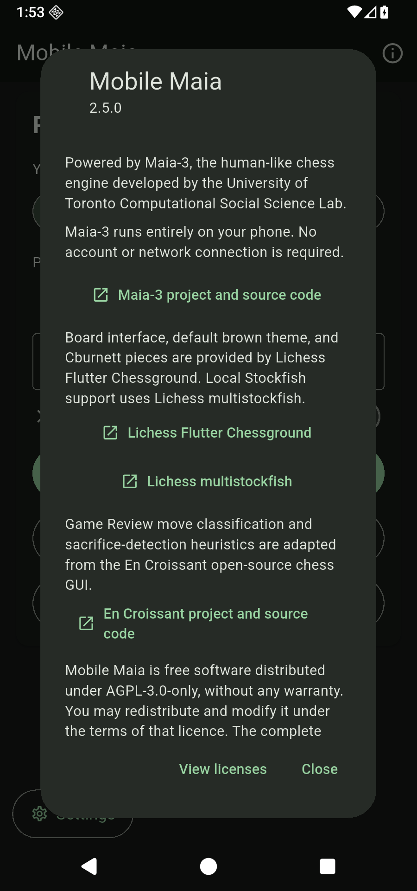
</p>

The app has no accounts, ads, subscriptions, tracking, or network dependency.
The download is several hundred megabytes because it bundles the
Maia-3 79M model so play and analysis stay on the device. The About screen
shows the installed version, AGPL terms, warranty notice, source and licence
links, and upstream credits.

Diagnostics are pruned to at most 14 days, 40 entries, 8,000 characters per
entry, and 128,000 characters total. They may include app, Android, hardware,
engine-cache, and privacy-safe Bluetooth state, but never a device serial,
Bluetooth address or board name, chess position, or PGN.

## Availability and forks

### Will Mobile Maia be available on Google Play or iPhone?

No. I will not publish Mobile Maia on Google Play or develop an official iPhone
version. This is a deliberate choice: in my view, Google's and Apple's tightly
controlled app-distribution ecosystems are at odds with the philosophy of free
and open-source software (FOSS), including the freedom to use, inspect, modify,
and share it. I respect that others may make different choices; this is the
approach I have chosen for Mobile Maia.

For context on the Android side, see F-Droid's
[An Open Letter Opposing Android Developer Verification](https://f-droid.org/en/2026/02/24/open-letter-opposing-developer-verification.html).

Official Android downloads and update options are available through GitHub,
F-Droid, Obtainium, and Zapstore, as described below.

A progressive web app (PWA) version is being developed at
[mobilemaia.org](https://mobilemaia.org/), offering a browser-based way to try
Mobile Maia without an app-store installation. You can already
[play the browser edition with Maia-3 5M](https://mobilemaia.org/play/);
it is not yet an installable or offline PWA.

### What about forks published in app stores?

Forks are welcome. Please honor the project's [AGPL-3.0-only licence](LICENSE)
and the applicable third-party licences documented in
[`THIRD_PARTY_NOTICES.md`](THIRD_PARTY_NOTICES.md). If you fork Mobile Maia and
publish your version in an app store, please do everything possible to avoid
confusion with this project. Use a distinct app name, icon, and package or bundle
identifier, and clearly state in the app and its store listing that it is an
independent fork, who maintains it, and where users should go for support.
Do not present your fork as an official Mobile Maia release or imply that it
is affiliated with, endorsed by, or maintained by this project.

## Install and update with F-Droid

Mobile Maia is available from the official F-Droid repository. Install the
[F-Droid client](https://f-droid.org/F-Droid.apk), then search for **Mobile
Maia** or open the
[Mobile Maia package page](https://f-droid.org/packages/com.dash1971.maia_chess/)
on your Android device. F-Droid can install the app and notify you when future
updates are available.

The package page also provides a direct APK download for manual installation.

## Install and update with Obtainium

[Obtainium](https://github.com/ImranR98/Obtainium) installs Android apps directly
from their official release pages and can notify you when updates are available.

1. Install Obtainium from its
   [official releases page](https://github.com/ImranR98/Obtainium/releases/latest).
2. Open Obtainium, select **Add App**, and paste this URL into **App Source URL**:

   ```text
   https://github.com/Dash1971/maia-chess-android
   ```

3. Confirm that Obtainium detects **GitHub** as the source. Leave
   **Include prereleases** disabled to receive stable versions only.
4. Select **Add**, open **Mobile Maia** in Obtainium, and select **Install**.
5. If Android asks, allow Obtainium to install unknown apps, then approve the
   Mobile Maia APK installation.

After setup, use Obtainium's update check to download and install future Mobile
Maia releases. Android may ask you to confirm each update.

## Install and update with Zapstore

Mobile Maia has a [developer-published Zapstore listing](https://zapstore.dev/apps/com.dash1971.maia_chess)
for its signed Stable APK. Install the Zapstore client from its
[official site](https://zapstore.dev/), then open the Mobile Maia listing in the
client to install it and check for updates. A new GitHub release reaches this
channel only after the developer publishes and verifies it on Zapstore; the
repository's `zapstore.yaml` does not publish updates automatically. Maintainers
should follow the [Zapstore post-release step](docs/RELEASING.md#publish-the-verified-stable-apk-to-zapstore).

## Support and contributing

- **Stable bugs:** [Search or open an issue in this repository](https://github.com/Dash1971/maia-chess-android/issues).
- **Preview bugs and feature requests:** [Search or open an issue in the Preview repository](https://github.com/Dash1971/maia-chess-android-preview/issues).

Check existing issues before opening a new one. For bug reports, include the app
version and channel, Android version and device, steps to reproduce, and what
you expected to happen. A small PGN/FEN example or diagnostics can help when
relevant.

Code, documentation, translations, and testing contributions are welcome.
Discuss substantial changes in a Preview issue before starting, so the approach
and scope can be agreed. New features are developed and tested in Preview before
promotion to Stable. Use the pinned toolchain and follow the
[testing guide](tool/hardening/README.md). Contributions are accepted under the
[project's licence](LICENSE).

## Build

Requirements: **Flutter 3.47.5** (pinned in `.fvmrc`), JDK 17, Android SDK 36,
Python 3, and Git LFS. Use the locked dependencies. A GitHub source ZIP contains
an LFS pointer rather than the 316 MB Maia model, so clone with Git LFS:

```sh
git clone https://github.com/Dash1971/maia-chess-android.git
cd maia-chess-android
git lfs install
git lfs pull
python3 tool/verify_model.py
flutter pub get --enforce-lockfile
flutter analyze
flutter test
tool/build_android_release.sh
```

The APK is written to `build/app/outputs/flutter-apk/app-release.apk`. The build
script verifies the bundled model's size and SHA-256 before building.

Further documentation:

- [Reproducible builds](REPRODUCIBLE_BUILDS.md): build environment and independent APK comparison.
- [Testing guide](tool/hardening/README.md): additional regression tests.
- [Release procedure](docs/RELEASING.md) and [release verification](tool/hardening/RELEASE_CHECKS.md): signing, qualification, and publication.

The official signing certificate SHA-256 digest is:

```text
cd6c07c4efacf52bcccb83009b522c1dcad4a171197505a486f0a58edb6f172e
```

## Re-export Maia-3

The checked-in ONNX model was exported from the official Maia-3 79M checkpoint.
The exporter verifies ONNX Runtime outputs against PyTorch before succeeding.

```sh
python -m pip install /path/to/maia3 onnx onnxruntime
python tool/export_maia3_onnx.py --model maia3-79m --output assets/models/maia3-79m.onnx
```

## Credits and attributions

Mobile Maia uses the
[Maia-3 project](https://github.com/CSSLab/maia3) and its 79M model. Maia-3 was
created by the University of Toronto Computational Social Science Lab to model
human chess move choices at different rating levels.

The board interface is provided by
[Lichess Flutter Chessground](https://github.com/lichess-org/flutter-chessground),
including the default Lichess brown theme and Cburnett pieces. Local Stockfish
support uses
[Lichess multistockfish](https://github.com/lichess-org/dart-multistockfish).
Opening names and ECO codes come from the CC0
[Lichess chess-openings dataset](https://github.com/lichess-org/chess-openings),
pinned to the source revision recorded in
[`THIRD_PARTY_NOTICES.md`](THIRD_PARTY_NOTICES.md). Analysis Board interactions
are also informed by the open-source
[Lichess Mobile analysis experience](https://github.com/lichess-org/mobile).
Mobile Maia is independently implemented and is not affiliated with Lichess.

Experimental Chessnut support uses Chessnut's
[published e-board API](https://github.com/chessnutech/Chessnut_eBoards) and
MIT-licensed [EasyLinkSDK](https://github.com/chessnutech/EasyLinkSDK), and was
cross-checked against Roberto Marabini's GPL-3.0
[chessnutair](https://github.com/rmarabini/chessnutair) reference
implementation. Mobile Maia's Bluetooth transport uses Android's native BLE
APIs. Protocol sources, copyright notices, licence terms, and adaptation
details are recorded in [`THIRD_PARTY_NOTICES.md`](THIRD_PARTY_NOTICES.md).

Game Review's move-classification and sacrifice-detection heuristics are
adapted and translated to Dart from
[En Croissant](https://github.com/franciscoBSalgueiro/en-croissant), the
open-source chess GUI by Francisco Salgueiro and contributors. The pinned
upstream revision and licence details are recorded in
[`THIRD_PARTY_NOTICES.md`](THIRD_PARTY_NOTICES.md).

The double-press NEW GAME Chessnut e-board behavior was inspired by [MoveAPiece](https://github.com/egdels/moveapiece) by [egdels](https://github.com/egdels).

The **Max variety in opening** idea is credited to
[Maia3-tauri](https://github.com/outusuke/maia3-tauri) by outusuke. This is an
idea attribution; no Maia3-tauri source code is incorporated for this feature.

## Licensing

Copyright (c) 2026 Dash. Original application code in this repository is
licensed under the [GNU Affero General Public License v3.0 only](LICENSE)
(`AGPL-3.0-only`). Contributions are accepted under the same licence.

Mobile Maia as a combined application is distributed under AGPL-3.0-only.
Individual third-party components retain their respective copyright notices
and licences, notably Maia-3 (AGPL-3.0), Stockfish/multistockfish (GPL-3.0),
dartchess (GPL-3.0), and adapted En Croissant code (GPL-3.0). See
[`THIRD_PARTY_NOTICES.md`](THIRD_PARTY_NOTICES.md).

This is an independent community project and is not an official Maia Chess,
University of Toronto CSSLab, Stockfish, Lichess, or En Croissant application.
