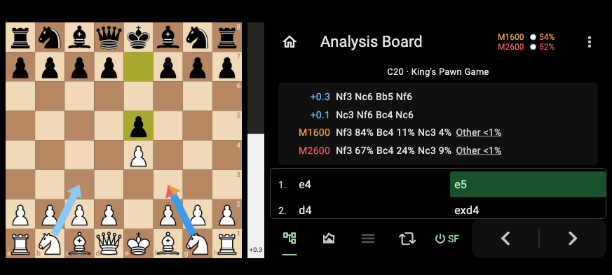
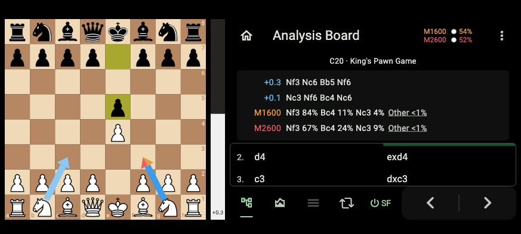
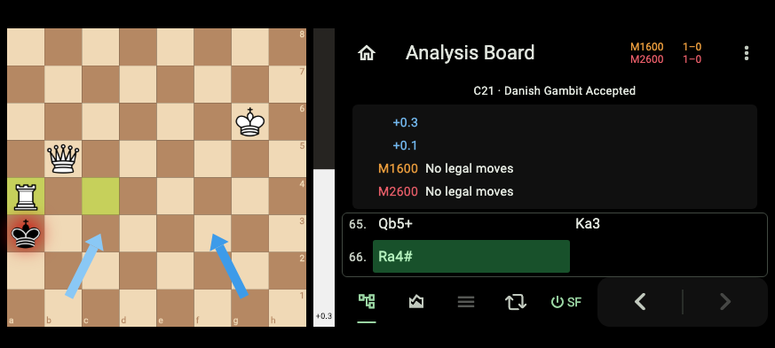
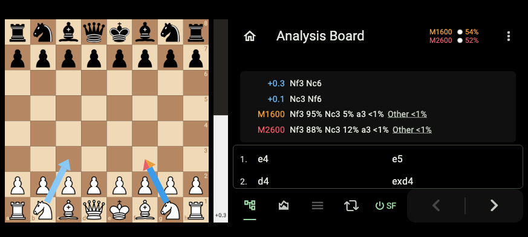
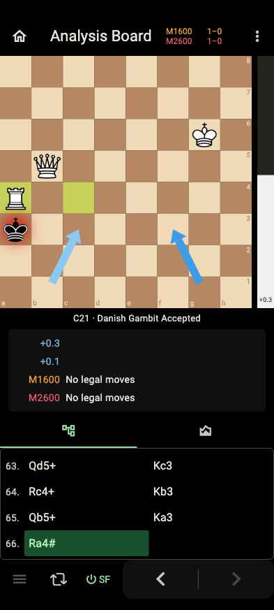
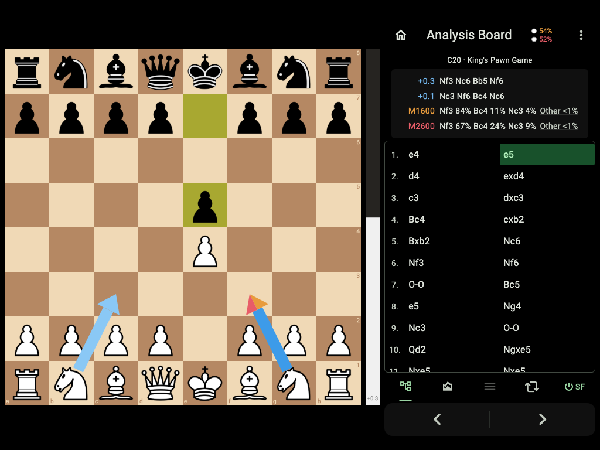

# Fixed engine analysis and independent moves for 2.6

Stable 2.6 draft: this behavior is promoted from Preview. The recorded tests,
renders and APK qualification below describe Preview, not a newly qualified
Stable build. Shared-screen screenshots are recorded separately; exact-source Stable checks remain pending.

Scrolling the move list, stepping through moves, or holding Back/Forward keeps
the engine analysis in view. The board, analysis header, and navigation controls
stay in their own regions. There is no nested coordinator and no shared outer
scroll surface that can push the engine output offscreen.

The move list and computer-analysis content each have their own scroll position.
Only their own viewport scrolls when revealing a selected move. Holding Back
shows the initial board and first move row (no move is highlighted before move
1); holding Forward selects and reveals the final move. Repeated holds reveal
the destination after browsing away without resetting the board or restarting
analysis. Existing side-variation return-to-main-line behavior is preserved.
Selected moves are revealed on opening a saved position and after rotation.

In landscape, the existing Moves/Computer analysis tabs sit in the bottom
control strip rather than consuming a separate row above the move list. This
leaves room for both Stockfish lines, both Maia rows, and a usable move window
on a landscape phone while preserving the larger square board. Tablet boards
retain the available-height layout and readable analysis-pane width.

At larger text sizes or constrained heights, the engine header has its own
bounded scroll area. Scrolling the moves never changes that area's position
or scroll offset. Portrait also uses separate bounded regions and reserves a
complete text-scaled move height. The existing exceptionally short-window
fallback keeps controls reachable; those dimensions do not replace phone and
tablet acceptance.

## Actual-widget behavior frames

These are Flutter host renders with bundled artwork, local Roboto, deterministic
engine fixtures, and 24/16-pixel top/bottom system insets. They are not Android
or physical-device captures.

Phone before scrolling:



Phone after manually scrolling only the moves. The board and engine output are
unchanged and remain at the same coordinates:



Phone after holding Forward. The position and engine results update, and the
final move is highlighted inside the move window; the engine pane stays visible:



Phone after holding Back:



Portrait after holding Forward:



4:3 tablet, 1024 × 768:



## Verification and limits

Original feature-PR validation: 1,445 full host tests passed, four skipped. All 129 focused layout/opening/navigation checks passed with local Roboto; Flutter analysis reported no issues.

`test/analysis_nested_scroll_test.dart` now checks the fixed-pane requirement.
It asserts header geometry and scroll offset remain unchanged during move
scrolling, and the header stays visible during endpoint holds. Normal-font
phone/tablet cases also assert the complete engine panel fits inside its
viewport. The suite retains endpoint, saved-game, editable-line, graph-tab,
empty-position, repeated-hold, engine-stability and rotation regressions.

Viewports include portrait phones/tablets and landscape 873 × 393, 1024 × 600,
1280 × 800, 1024 × 768, and 800 × 600 at normal and 200% text. Host tests establish
Flutter layout and gesture routing; physical tablet touch acceptance remains
outstanding under [Preview #29](https://github.com/Dash1971/maia-chess-android-preview/issues/29). The original feature PR used no Android builds, Actions or LFS downloads; the published beta.9 qualification below is separate.
No shared build/CI/verification/cleanup helpers changed; Stable receives this
app layout through the normal 2.6 promotion.

To reproduce the behavior frames with the pinned Flutter SDK:

```sh
MAIA_REPORT_FONT=/absolute/path/to/Roboto-Regular.ttf \
MAIA_ANALYSIS_CAPTURES=/absolute/path/to/task-scratch/renders \
flutter test --no-pub test/analysis_nested_scroll_test.dart
```

## Earlier released behavior

Beta.7 used a single continuous pane; beta.8 delivered [Preview #246](https://github.com/Dash1971/maia-chess-android-preview/issues/246)'s coordinated nested
scrolling. Their release evidence qualifies those earlier sources. This follow-up
removes the behavior that lets move scrolling or reveal animations hide engine
analysis, and is published with separate beta.9 release qualification recorded below.

## Preview beta.9 Android qualification

[Published beta.9](https://github.com/Dash1971/maia-chess-android-preview/blob/e162a61e995452b748e5f85d710c6f7dab2ab24a/docs/releases/preview-2.6.0-beta.9.md) delivers [Preview #249](https://github.com/Dash1971/maia-chess-android-preview/issues/249). Actual production-signed ARM64 APK checks verify independent engine/move panes during scrolling, stepping and endpoint holds, normal/large text, graph requests, rotation and short-window control access. Normal-font profiles show all four engine rows; constrained large text retains independent header scrolling. Earlier illustrations are host renders. Physical touch/tablet acceptance under [Preview #29](https://github.com/Dash1971/maia-chess-android-preview/issues/29) and Stable promotion remain separate.
