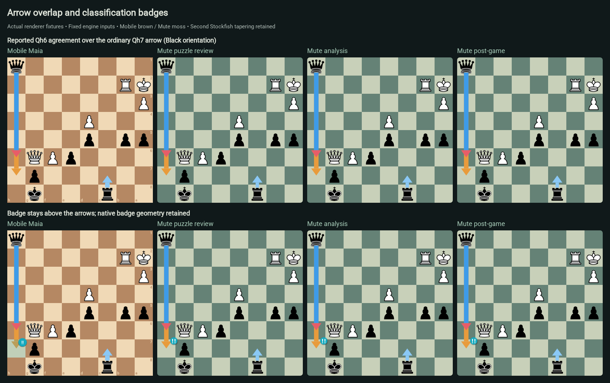

# Arrow behavior and classification badges

Mobile Maia's review board paints its ordinary engine arrows, then its agreement
overlay, then the selected move's classification badge. This page records that
contract and links the actual renderer comparison with Mute Chess.

## Engine colors and agreements

| Source | Shaft | Head |
| --- | --- | --- |
| Stockfish best | Blue `#3d9be9` | Blue |
| Stockfish second | Light blue `#8ac8f5` | Light blue |
| Primary Maia | Orange `#e89b3c` | Orange |
| Second Maia | Red `#e85d68` | Red |
| Stockfish and a Maia | Corresponding Stockfish blue | Agreeing Maia color |
| Both Maias, without Stockfish | Split orange/red | Split orange/red |
| Stockfish and both Maias | Corresponding Stockfish blue | Split orange/red |

Each Maia contributes its one top move; Stockfish contributes up to two unique
PV roots. Ordinary arrows follow SF1, SF2, Maia1, Maia2 order. Agreements follow
Maia insertion order in a later overlay. Consequently, agreements sit above
ordinary overlapping arrows. There is no separate rule that all Stockfish arrows
must be painted last. Both ordinary and agreement arrows are above pieces.

`ReviewBoardOverlayPainter` draws agreements first, then the classified-square
translucent tint, then the badge circle and white symbol. The six classifications
use the same colors as the summary: Brilliant cyan, Good teal, Interesting lime,
Dubious yellow, Mistake orange and Blunder red. Engine-source colors do not mean
move quality.

The reference for this audit is commit
[`be6b97c`](https://github.com/Dash1971/maia-chess-android/commit/be6b97cd5ec0c1386233fbd824183c4fbb9c6efd),
particularly [selection and agreements](https://github.com/Dash1971/maia-chess-android/blob/be6b97cd5ec0c1386233fbd824183c4fbb9c6efd/lib/src/review.dart#L1838)
and [the overlay painter](https://github.com/Dash1971/maia-chess-android/blob/be6b97cd5ec0c1386233fbd824183c4fbb9c6efd/lib/src/review_widgets.dart#L928).

## Mute Chess comparison

[Mobile issue #75](https://github.com/Dash1971/maia-chess-android/issues/75) ·
[Mute issue #328](https://github.com/Dash1971/mute-chess/issues/328)

The companion Mute change fixes a rare overlap: Stockfish/second Maia's Qh6
agreement could be covered by primary Maia's ordinary Qh7. It also handles native
Chessground's retained SVG nodes when asynchronous results change agreement.
Mobile Maia's application behavior is unchanged by this documentation/test PR.

Mute deliberately retains Lichess's evaluation-based tapering of an independent
second Stockfish arrow. Mobile Maia keeps fixed-width shafts. Mute also retains
native Lichess SVG badge geometry/stacking and existing custom-color/visibility
preferences; Mobile uses its circle/text and classified-square tint. The shared
contract is source meaning, agreement order, geometry alignment and badges above
arrows, not identical fonts, board colors or badge shapes.

The [complete evidence and feature page](https://github.com/Dash1971/mute-chess/blob/586aaafc8ba29ccbe3796c355eced8950d796302/docs/arrow-behavior.md) contains all 96
Flutter board captures beside the 288 actual Mute puzzle-review, standalone and
post-game surface-path captures. It covers all 32 canonical source-presence/
agreement partitions, both orientations, all six badges, crossings, opposite
rays, knight vectors, promotion, castling, short/long arrows, shared destinations,
a small board and tapering. Mute additionally checks six sequential DOM updates
and 21 preference/hover/threat cases. Inputs are deterministic rendering fixtures,
not claims about live model output. The reported position is reconstructed from
the owner's screenshot rather than retrieved from a puzzle service.

These are **real board-renderer captures**, not full-device/full-page navigation
screenshots. Flutter selections come from injected `ReviewPage` engine boundaries,
then its actual Chessground widget and production `ReviewBoardOverlayPainter`.
The Mute fixture invokes its real three surface selection/annotation paths with
stub controller inputs, actual Chessground, production CSS and native badge SVGs.



## Reproduce the Flutter checks and captures

The focused test and common inputs are
[`test/arrow_behavior_test.dart`](../test/arrow_behavior_test.dart) and
[`test/fixtures/arrow_behavior.json`](../test/fixtures/arrow_behavior.json).
They require no engine inference or materialized model. Use the existing shared
Flutter SDK/caches and follow [build storage rules](BUILD_WORKSPACE.md):

```sh
python3 tool/build_workspace.py preflight
flutter test test/arrow_behavior_test.dart --reporter expanded
```

To capture, set `ARROW_CAPTURE_DIR` to a task-owned evidence directory. For readable
badge text in this **headless test runner only**, apply
[the capture-only font patch](arrow-behavior/headless-font.patch) and point
`ARROW_CAPTURE_FONT` to the shared SDK's existing `Roboto-Regular.ttf`:

```sh
git apply docs/arrow-behavior/headless-font.patch
ARROW_CAPTURE_FONT=/absolute/shared/flutter/bin/cache/artifacts/material_fonts/Roboto-Regular.ttf \
ARROW_CAPTURE_DIR=/absolute/task/evidence/mobile \
flutter test test/arrow_behavior_test.dart --reporter expanded
git apply -R docs/arrow-behavior/headless-font.patch
flutter test test/arrow_behavior_test.dart --reporter expanded
```

Flutter normally renders unspecified test fonts as Ahem rectangles. The temporary
patch only supplies `fontFamily: 'Roboto'` to the existing badge TextStyle; no
geometry, colors, source selection or paint order changes. It is **not applied in
the PR** and must never be included in an app release. The final 96 assertions were
also run against the original, unmodified production painter. Async image decoding
is allowed to settle before snapshots so pieces are actually visible.

No model, classifier, production string, service, release or deployment changes
are part of this companion. The side-by-side gallery records the intentionally
different tapering and native badge appearance rather than hiding them.
